# PrepForge 1.0 - Complete UML Class Diagram

## Architectural Overview: 4-Tier Architecture
$$\text{UI Layer} \longrightarrow \text{Service Layer} \longrightarrow \text{DAO Layer} \longrightarrow \text{Database (MySQL)}$$

---

## Mermaid UML Class Diagram

```mermaid
classDiagram
    direction TB

    %% ==========================================
    %% EXCEPTION HIERARCHY
    %% ==========================================
    class Exception {
        <<checked>>
    }

    class PrepForgeException {
        +PrepForgeException(String message)
        +PrepForgeException(String message, Throwable cause)
    }

    class ValidationException {
        +ValidationException(String message)
    }

    class DataAccessException {
        +DataAccessException(String message)
        +DataAccessException(String message, Throwable cause)
    }

    Exception <|-- PrepForgeException : extends
    PrepForgeException <|-- ValidationException : extends
    PrepForgeException <|-- DataAccessException : extends

    %% ==========================================
    %% DOMAIN & OOP MODEL CLASSES
    %% ==========================================
    class User {
        <<abstract>>
        -int id
        -String name
        -String email
        -String passwordHash
        +User(int id, String name, String email)
        +getId() int
        +setId(int id) void
        +getName() String
        +setName(String name) void
        +getEmail() String
        +setEmail(String email) void
        +getPasswordHash() String
        +setPasswordHash(String hash) void
        +getRole()* String
        +showMenu()* void
    }

    class Student {
        -String enrollmentNumber
        -String branch
        -double cgpa
        -List~Skill~ skills
        -Map~int, String~ skillProficiency
        -Set~int~ appliedRoleIds
        +Student(int id, String name, String email, String enrollment, String branch, double cgpa)
        +getRole() String
        +showMenu() void
        +updateProfile(String name, String email) void
        +updateProfile(String name, String email, String branch, double cgpa) void
        +updateProfile(Student s) void
        +addSkill(Skill skill, String level) void
        +removeSkill(int skillId) void
        +hasSkill(int skillId) boolean
        +applyToRole(int roleId) void
        +hasAppliedToRole(int roleId) boolean
        +getCgpa() double
        +setCgpa(double cgpa) void
    }

    class Admin {
        -String department
        -String employeeCode
        +Admin(int id, String name, String email, String department, String employeeCode)
        +getRole() String
        +showMenu() void
        +getDepartment() String
        +setDepartment(String dept) void
        +getEmployeeCode() String
        +setEmployeeCode(String code) void
    }

    class Skill {
        -int skillId
        -String skillName
        -String category
        +Skill(int skillId, String skillName, String category)
        +getSkillId() int
        +getSkillName() String
        +getCategory() String
        +equals(Object o) boolean
        +hashCode() int
    }

    class Company {
        -int companyId
        -String name
        -String description
        -String location
        -String industry
        -List~JobRole~ jobRoles
        +Company(int companyId, String name, String location, String industry)
        +addJobRole(JobRole role) void
        +getCompanyId() int
        +getName() String
        +getDescription() String
        +getLocation() String
        +getJobRoles() List~JobRole~
    }

    class JobRole {
        -int roleId
        -String title
        -double minCgpa
        -Company company
        -Set~Skill~ requiredSkills
        +JobRole(int roleId, String title, double minCgpa, Company company)
        +addRequiredSkill(Skill skill) void
        +isCgpaEligible(double studentCgpa) boolean
        +getRoleId() int
        +getTitle() String
        +getMinCgpa() double
        +getCompany() Company
        +getRequiredSkills() Set~Skill~
    }

    User <|-- Student : Inheritance (IS-A)
    User <|-- Admin : Inheritance (IS-A)

    JobRole --> Company : Association (belongs to)
    Company o-- JobRole : Aggregation (jobRoles)
    Student o-- Skill : Aggregation (skills)
    JobRole o-- Skill : Aggregation (requiredSkills)

    %% ==========================================
    %% UTILITY CLASSES
    %% ==========================================
    class Validator {
        <<utility>>
        -String EMAIL_REGEX$
        +isValidEmail(String email)$ boolean
        +isValidPassword(String password)$ boolean
        +isValidCgpa(double cgpa)$ boolean
        +validateEmail(String email)$ void
        +validatePassword(String password)$ void
        +validateName(String name)$ void
        +validateCgpa(double cgpa)$ void
        +validatePositiveId(int id, String field)$ void
    }

    class PasswordHasher {
        <<utility>>
        -String ALGORITHM$
        -int ITERATIONS$
        -int KEY_LENGTH$
        +hashPassword(String plainPassword)$ String
        +verifyPassword(String plainPassword, String storedHash)$ boolean
    }

    %% ==========================================
    %% DAO (DATA ACCESS OBJECT) LAYER
    %% ==========================================
    class UserDao {
        <<interface>>
        +findByEmail(String email) User
        +saveStudent(Student s, String hash) void
        +saveAdmin(Admin a, String hash) void
        +findStudentById(int id) Student
        +updateStudent(Student s) void
        +addStudentSkill(int studentId, int skillId, String level) void
        +removeStudentSkill(int studentId, int skillId) void
        +findAllSkills() List~Skill~
        +findAllStudents() List~Student~
        +deleteStudent(int studentId) void
    }

    class InMemoryUserDao {
        -Map~int, User~ userDatabase
        -Map~String, User~ emailIndex
        -Map~int, Skill~ skillCatalog
    }

    class PlacementDao {
        <<interface>>
        +findAllCompanies() List~Company~
        +findCompanyById(int id) Company
        +saveCompany(Company c) void
        +findAllJobRoles() List~JobRole~
        +findJobRoleById(int id) JobRole
        +saveJobRole(JobRole r) void
        +saveApplication(int studentId, int roleId) void
        +hasApplied(int studentId, int roleId) boolean
    }

    class InMemoryPlacementDao {
        -Map~int, Company~ companyMap
        -Map~int, JobRole~ jobRoleMap
        -Map~int, Set~int~~ applications
    }

    UserDao <|.. InMemoryUserDao : Realization
    PlacementDao <|.. InMemoryPlacementDao : Realization

    %% ==========================================
    %% SERVICE LAYER
    %% ==========================================
    class UserService {
        -UserDao userDao
        +UserService(UserDao dao)
        +login(String email, String password) User
        +registerStudent(Student s, String password) void
        +registerAdmin(Admin a, String password) void
        +getProfile(int studentId) Student
        +updateProfile(Student s) void
        +addSkill(int studentId, int skillId, String level) void
        +removeSkill(int studentId, int skillId) void
        +getAllSkills() List~Skill~
        +getAllStudents() List~Student~
        +deleteStudent(int studentId) void
    }

    class PlacementService {
        -PlacementDao placementDao
        -UserDao userDao
        +PlacementService(PlacementDao pDao, UserDao uDao)
        +getAllCompanies() List~Company~
        +getEligibleRoles(int studentId) List~JobRole~
        +applyToRole(int studentId, int roleId) void
        +saveCompany(Company c) void
        +saveJobRole(JobRole r) void
    }

    UserService --> UserDao : uses
    UserService ..> Validator : validates with
    UserService ..> PasswordHasher : hashes with

    PlacementService --> PlacementDao : uses
    PlacementService --> UserDao : verifies student
    PlacementService ..> Validator : validates with
```

---

## Notation & Relationship Legend

| Symbol | Relationship | Description | Example in PrepForge |
|---|---|---|---|
| `<\|--` | **Inheritance (`IS-A`)** | Child class inherits attributes & methods from parent. | `Student` extends `User` |
| `<\|..` | **Realization** | Class implements an interface contract. | `InMemoryUserDao` implements `UserDao` |
| `o--` | **Aggregation (`HAS-A`)** | Whole/part relationship where parts can exist independently. | `Company` has `JobRoles`, `Student` has `Skills` |
| `-->` | **Association** | One class references another class. | `JobRole` references `Company` |
| `..>` | **Dependency** | Class uses another class temporarily (method parameter or static call). | `UserService` uses `Validator` and `PasswordHasher` |
